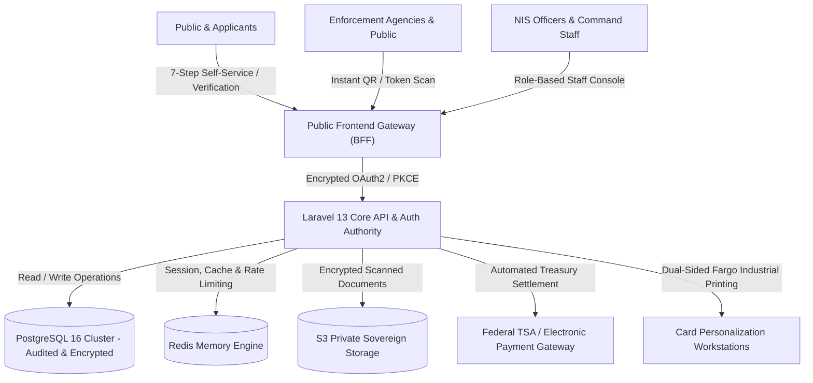
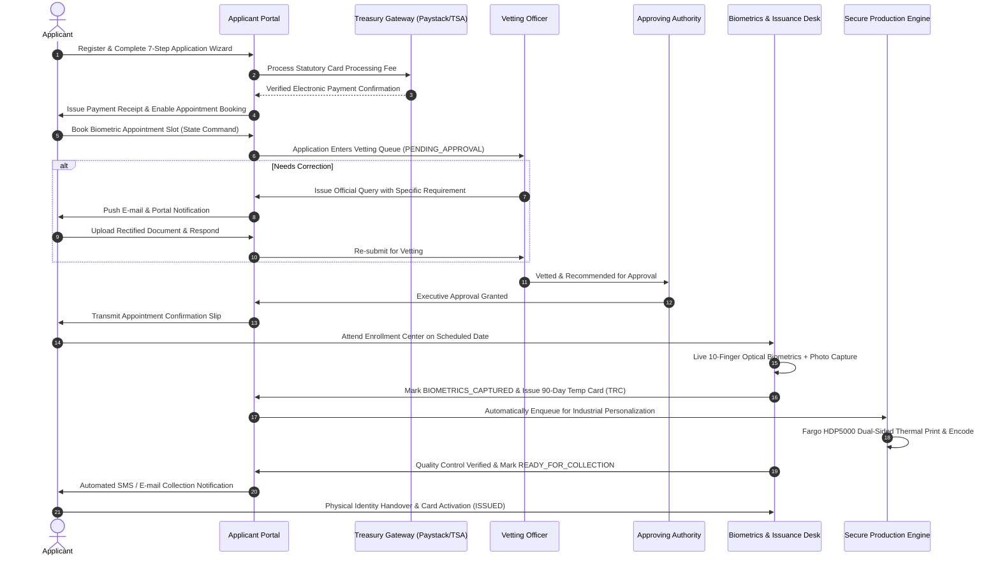

# COMPREHENSIVE PROJECT PROPOSAL

## DEPLOYMENT, MODERNIZATION, AND OPERATIONALIZATION OF THE ECOWAS RESIDENCE CARD ISSUANCE & VERIFICATION SYSTEM (NIS-RCIS)

---

**SUBMITTED TO:**  
**The Comptroller General of Immigration (CGI)**  
Nigeria Immigration Service (NIS)  
National Headquarters, Nnamdi Azikiwe International Airport Expressway,  
Sauka, Abuja, Federal Capital Territory, Nigeria  

**THROUGH:**  
**The Deputy Comptroller General (DCG)**  
Directorate of Visa and Residency  
Nigeria Immigration Service, National Headquarters, Abuja  

**AND:**  
**The Honourable Minister of Interior**  
Federal Ministry of Interior, Block F, Old Federal Secretariat,  
Garki, Abuja, Nigeria  

---

**DOCUMENT IDENTIFIERS:**  
- **Document Reference:** `NIS/HQ/DVR/RCIS/PROP/2026/V2.4`  
- **Project Title:** Nigeria Immigration Service Residence Card Issuance System (NIS-RCIS)  
- **Classification:** RESTRICTED / OFFICIAL COMMERCE  
- **Submission Date:** October 2026  
- **Status:** Final Executive Submission  

---

## TABLE OF CONTENTS

1. [Executive Summary](#1-executive-summary)  
2. [Statutory Mandate & Regulatory Framework](#2-statutory-mandate--regulatory-framework)  
3. [Operational Problem Statement & The Case for Modernization](#3-operational-problem-statement--the-case-for-modernization)  
4. [Proposed Solution Overview (The NIS-RCIS Platform)](#4-proposed-solution-overview-the-nis-rcis-platform)  
5. [Enterprise System Architecture & Security Engineering](#5-enterprise-system-architecture--security-engineering)  
6. [Physical Card Engineering & Biometric Specifications](#6-physical-card-engineering--biometric-specifications)  
7. [End-to-End Operational Lifecycle & Workflow](#7-end-to-end-operational-lifecycle--workflow)  
8. [Revenue Assurance, Treasury Integration & Anti-Leakage Controls](#8-revenue-assurance-treasury-integration--anti-leakage-controls)  
9. [National Security, Law Enforcement & Border Interoperability](#9-national-security-law-enforcement--border-interoperability)  
10. [Data Sovereignty, Privacy & NDPA 2023 Compliance](#10-data-sovereignty-privacy--ndpa-2023-compliance)  
11. [Infrastructure, Hardware Sizing & Deployment Topology](#11-infrastructure-hardware-sizing--deployment-topology)  
12. [Project Rollout Strategy & Phased Implementation Timeline](#12-project-rollout-strategy--phased-implementation-timeline)  
13. [Institutional Capacity Building & Change Management](#13-institutional-capacity-building--change-management)  
14. [Service Level Agreements, Disaster Recovery & Support Model](#14-service-level-agreements-disaster-recovery--support-model)  
15. [Financial Model, Commercial Terms & Return on Investment (ROI)](#15-financial-model-commercial-terms--return-on-investment-roi)  
16. [Conclusion & Recommendations](#16-conclusion--recommendations)  
17. [Sign-Off & Approval Block](#17-sign-off--approval-block)  

---

## 1. EXECUTIVE SUMMARY

The Nigeria Immigration Service (NIS), functioning under the statutory oversight of the Federal Ministry of Interior and the Civil Defence, Correctional, Fire and Immigration Services Board (CDCFIB), is charged with the critical constitutional and legal mandate of regulating the entry, residence, employment, and departure of non-Nigerian nationals.

Within the context of the Economic Community of West African States (ECOWAS), Nigeria has long championed regional integration while remaining vigilant regarding national security, population tracking, internal stability, and revenue protection. While the **1979 ECOWAS Protocol on Free Movement of Persons, Right of Residence and Establishment** grants community citizens the privilege to reside and engage in legitimate economic activities within member states, this right is explicitly subject to domestic registration, regular verification, and statutory documentation by the host nation.

The **NIS-RCIS (Nigeria Immigration Service - Residence Card Issuance System)** represents a purpose-built, government-grade, digitally sovereign platform engineered to modernize, automate, secure, and streamline the complete lifecycle of the **ECOWAS Residence Card**.

### Core Objectives of NIS-RCIS:
1. **National Security & Real-Time Monitoring:** Provide the Comptroller General of Immigration and intelligence services with instantaneous, tamper-proof visibility into all community citizens residing within the 36 States and the Federal Capital Territory (FCT).
2. **Elimination of Counterfeits & Forgery:** Replace easily cloned legacy identification with a state-of-the-art **CR80 ID-1 Smart Residence Card** featuring ultraviolet anti-counterfeit guilloche patterns, high-resolution biometric passport photographs, encrypted dynamic QR codes, and a 2-line **ICAO Doc 9303 Part 6 (TD2)** compliant Machine Readable Zone (MRZ).
3. **Revenue Maximization & 100% Treasury Collection:** Terminate cash-handling vulnerabilities and unauthorized intermediaries by enforcing end-to-end electronic payment processing integrated with the Federal Government Treasury Single Account (TSA) ecosystem, ensuring instant settlement, real-time auditing, and zero financial leakage.
4. **Transparent, Multi-Stage Vetting Workflow:** Digitize the administrative chain of custody through a role-segregated pipeline: Applicant Self-Service Portal &rarr; Vetting Officers &rarr; Approving Authorities &rarr; Biometric Capture Enrollers &rarr; Secure Industrial Production (Fargo HDP5000 retransfer printers) &rarr; Quality Controlled Issuance & Collection.
5. **Data Protection & Legal Compliance:** Comply strictly with the **Nigeria Data Protection Act (NDPA) 2023**, ensuring all personal information, biometric templates, and document scans are securely stored within Nigerian territorial boundaries under AES-256 encryption.

---

## 2. STATUTORY MANDATE & REGULATORY FRAMEWORK

The deployment and enforcement of the NIS-RCIS platform derive absolute legal authority from established domestic statutes, international treaties, and service regulations:

```
┌────────────────────────────────────────────────────────────────────────┐
│                      LEGAL & STATUTORY PILLARS                         │
├────────────────────────────────────────────────────────────────────────┤
│ 1. Immigration Act, 2015 (Sections 18, 20, 31, 33, 37, 72 & 105)       │
│ 2. Nigeria Immigration Regulations, 2017                               │
│ 3. 1979 ECOWAS Protocol on Free Movement of Persons, Residence & Estab.│
│ 4. Supplementary Protocols A/SP.1/7/85 and A/SP.1/5/90                 │
│ 5. Nigeria Data Protection Act (NDPA), 2023                            │
│ 6. Cybercrimes (Prohibition, Prevention, etc.) Act, 2015               │
│ 7. ICAO Document 9303 (Machine Readable Travel Documents - Part 6 TD2) │
└────────────────────────────────────────────────────────────────────────┘
```

- **Immigration Act, 2015 (Section 31 & 33):** Mandates every non-Nigerian residing in Nigeria for a period exceeding 90 days to register with the Immigration Service and obtain the prescribed resident documentation.
- **Section 37, Immigration Act 2015:** Empowers the Comptroller General of Immigration to issue, renew, revoke, query, and enforce the conditions of residence permits and cards.
- **ECOWAS Free Movement Protocol (Articles 2, 5 & 11):** Explicitly preserves the sovereign right of host member states to issue Residence Cards to community citizens upon receipt of formal application, valid national passports, evidence of lawful livelihood/employment, and payment of statutory administrative processing fees.
- **Nigeria Data Protection Act, 2023:** Mandates strict data sovereignty, technical encryption, consent collection, and purpose-bound processing for all identity data collected from individuals on Nigerian soil.

---

## 3. OPERATIONAL PROBLEM STATEMENT & THE CASE FOR MODERNIZATION

Prior to the conception and development of the modern NIS-RCIS system, the management of residence documentation for ECOWAS citizens suffered from several critical operational bottlenecks:

| Operational Dimension | Legacy / Conventional Process | NIS-RCIS Modernized Solution |
|---|---|---|
| **Identity Verification** | Manual review of paper forms; vulnerability to fake national passports and counterfeit documents. | Automated cross-validation against ICAO MRZ standards, tamper-evident document upload, and automated identity deduplication. |
| **Card Security & Standards** | Non-standard card layouts, prone to physical tampering, lack of standardized MRZ, easily forged photo overlays. | Military-grade CR80 ID-1 card, high-resolution photo alignment, UV security inks, dynamic 2-line ICAO Doc 9303 TD2 MRZ, and encrypted QR verification. |
| **Revenue Collection** | Fragmented payment receipts, offline teller reconciliations, high incidence of revenue diversion and middleman arbitrage. | 100% automated electronic collection directly routed through audited gateways with instant automated transaction verification and webhook reconciliation. |
| **Audit & Accountability** | Paper registers and editable spreadsheet logs; impossible to reconstruct an indisputable chain of custody for queries or approvals. | Tamper-proof, append-only PostgreSQL database audit triggers recording every click, view, query, approval, revocation, and reprint with officer IP and timestamp. |
| **Biometric Integrity** | Isolated fingerprint capture devices without centralized optical template matching; duplicate enrollments went undetected. | Centralized 10-finger optical biometric capture, real-time live preview, quality threshold enforcement, and multi-biometric profile linking. |
| **Inter-Agency Verification** | Law enforcement officers at checkpoints and border posts had no mechanism to instantly verify card validity in real time. | Public and partner-agency mobile verification gateways via cryptographic QR scan and high-speed RESTful `/api/v1/partner/cards/verify` endpoints. |
| **Loss & Theft Reporting** | Stolen or lost cards remained active in circulation for years, enabling impersonation and criminal usage. | Immediate online applicant self-reporting, automated card invalidation, real-time national watchlist integration, and police report tracking. |

---

## 4. PROPOSED SOLUTION OVERVIEW (THE NIS-RCIS PLATFORM)

The **NIS-RCIS Platform** is an enterprise-grade, cloud-ready, dual-portal ecosystem engineered exclusively for the operational realities of the Nigeria Immigration Service.



### 4.1 Key System Modules

1. **Public Information & Advisory Portal:**
   - Multilingual interface supporting **English, French, and Portuguese** (the three official working languages of ECOWAS).
   - Real-time application tracker (`/track`) requiring both Application ID and Passport Number to protect personal privacy.
   - Public Card Verification module (`/verify`) allowing authorized employers, commercial banks, landlord associations, and law enforcement officers to validate physical card authenticity.
   - Built-in AI Regulatory Assistant providing instantaneous guidance on visa classifications, supporting document lists, and biometric appointment requirements without exposing backend database records.

2. **Applicant Self-Service Portal (`/portal`):**
   - Secure account registration with mandatory e-mail token verification and NDPA-compliant privacy consent recording.
   - Streamlined 7-Step Application Wizard:
     - *Step 1:* Category Selection (Work / Business / Student / Religious / Dependent).
     - *Step 2:* Personal Information & Contact Details.
     - *Step 3:* Passport & Nationality Particulars (ECOWAS member states).
     - *Step 4:* Domicile & Nigerian Residence Details (State, LGA, Address).
     - *Step 5:* Mandatory Supporting Document Upload with client-side and server-side virus/malware inspection.
     - *Step 6:* Electronic Fee Payment & Immediate Receipt Generation.
     - *Step 7:* Biometric Appointment Slot Scheduling at designated State Command Enrollment Centers.
   - Comprehensive Applicant Dashboard: View active application status, download PDF Appointment Slips, respond immediately to official officer queries, request Change of Data (COD), and report lost/stolen cards.

3. **Temporary Residence Card (TRC) Facility:**
   - Applicants who successfully complete biometric enrollment immediately receive an electronic, printable **Temporary Residence Card** valid for 90 days.
   - Features a tamper-evident QR verification code, allowing community citizens to legally work, conduct banking transactions, and move freely while their physical PVC card is undergoing personalization and delivery.

4. **Staff Administrative & Enforcement Console (`/staff`):**
   - Segregated role-based dashboard for immigration personnel across five operational tiers:
     - **SuperAdmin:** Full configuration, user provisioning, revenue monitoring, security audits, card revocations and reinstatements.
     - **Vetting Officer:** First-tier scrutiny of application particulars, nationality confirmation, employer checks, and document authenticity validation.
     - **Approving Authority:** Final executive review, application approval, or formal administrative query issuance.
     - **Issuing Officer / Biometrics Desk:** Live 10-finger optical biometric capture, applicant photo capture, signature capture, card batch printing, quality inspection, and physical handover.
     - **Auditor:** Independent, read-only oversight over the append-only audit trail, financial transactions, and operational metrics.

5. **Residence Card Production & Issuance Engine:**
   - Automated batch generation for dual-sided industrial thermal retransfer printers (e.g., Fargo HDP5000).
   - Production queue separation: Prevents cards from being printed until both final executive approval and biometrics capture have succeeded.
   - Physical handover reconciliation: Strict recording of collected vs. spoiled card inventory, tracking card blanks down to individual serial numbers.

6. **Lost / Stolen Card & Watchlist Management:**
   - Dedicated law enforcement module allowing immediate blacklisting of reported cards.
   - Real-time status propagation across all border checkpoints, airport immigration counters, and partner agency verification APIs.

---

## 5. ENTERPRISE SYSTEM ARCHITECTURE & SECURITY ENGINEERING

The NIS-RCIS technical architecture has been designed around a **Zero-Trust Security Philosophy**, adhering to the highest international security benchmarks:

```
  CLIENT / BROWSER TIER
  ┌────────────────────────────────────────────────────────────────────────┐
  │  Next.js 16 (React 19, TypeScript, Tailwind CSS 4)                    │
  │  - Backend-For-Frontend (BFF) Architecture                             │
  │  - Zero OAuth tokens exposed to client browsers                        │
  │  - AES-256-GCM Encrypted HttpOnly, SameSite=Lax Session Cookies        │
  │  - Strict Content Security Policy (CSP), HSTS, & Frame Deny            │
  └───────────────────────────────────┬────────────────────────────────────┘
                                      │ Internal Reverse Proxy
  APPLICATION & IDENTITY TIER         ▼
  ┌────────────────────────────────────────────────────────────────────────┐
  │  Laravel 13 Enterprise REST Core (PHP 8.5)                             │
  │  - OAuth2 Server (Laravel Passport) with PKCE & Strict Scope Enforce   │
  │  - Multi-Guard Identity Partition: Officers (users) vs Public (appli.) │
  │  - State-Machine Enforced Workflows with Strict Database Row-Locks     │
  │  - Deep File & Malware Inspection Pipeline (ClamAV, MIME, Stego-strip) │
  └───────────────────────────────────┬────────────────────────────────────┘
                                      │ Encrypted Network Bus
  DATA & STORAGE TIER                 ▼
  ┌────────────────────────────────────────────────────────────────────────┐
  │  PostgreSQL 16 High-Availability Relational Database                   │
  │  - Cryptographic Row-Level Tracking & Custom Collision-Free Sequences │
  │  - Immutable, Append-Only Forensic Audit Log Trigger                   │
  │  - In-Memory Redis Cluster (Queues, Distributed Locks, Rate Limits)    │
  │  - Private Sovereign S3 Object Store (Signed 10-minute temporary URLs) │
  └────────────────────────────────────────────────────────────────────────┘
```

### 5.1 Defense-in-Depth Security Controls

1. **OAuth2 Architecture with Strict Provider Separation:**
   - The platform strictly enforces OAuth2 Authorization Code Grant with **PKCE (Proof Key for Code Exchange)** for all first-party clients.
   - **Identity Partitioning:** Staff credentials authenticate strictly against the `users` provider, while applicants authenticate against the `applicants` provider. A compromised applicant token cannot under any circumstances access staff endpoints, and vice versa.
   - Access tokens have an ultra-short lifespan of 15 minutes; refresh tokens expire within 12 hours.

2. **Malware & Steganography Inspection Pipeline (`MalwareScanner`):**
   - All uploaded supporting documents (passports, CAC certificates, employment letters) undergo strict multi-layered validation:
     - Real MIME-type detection via `libmagic/finfo` (not relying on file extensions).
     - Full PDF syntax parsing to reject files containing embedded JavaScript, launch actions, or embedded binary streams.
     - Complete re-encoding of all uploaded image files (`imagecreatefromstring`), which permanently strips hidden payloads, executable steganography, and GPS coordinate metadata.
     - Integration capability with local ClamAV daemon antivirus engine.

3. **Immutable Forensic Audit Trail:**
   - Every single administrative action (viewing a passport, approving an application, querying a document, exporting a report, printing a card) is automatically committed to an immutable `audit_logs` table.
   - **PostgreSQL Database Trigger Enforcement:** An automated database-level trigger prohibits any `UPDATE` or `DELETE` SQL operations on the `audit_logs` table, ensuring even a compromised system administrator account cannot alter historical operational logs.

4. **Cryptographic Protection & Anti-Enumeration:**
   - Public tracking and card lookups enforce strict composite authentication keys (e.g., Application Number + Passport Number).
   - Public endpoints are governed by sliding-window rate limiters (backed by Redis), preventing automated brute-force enumeration attacks.

---

## 6. PHYSICAL CARD ENGINEERING & BIOMETRIC SPECIFICATIONS

The physical ECOWAS Residence Card produced by the NIS-RCIS engine is engineered to the highest global credentials standards, fully compliant with **ICAO Doc 9303 Part 6 (TD2 - 85.6 mm &times; 54.0 mm CR80 ID-1 standard)**:

```
┌──────────────────────────────────────────────────────────────────────────────┐
│  FEDERAL REPUBLIC OF NIGERIA · NIGERIA IMMIGRATION SERVICE      [COAT OF ARMS]│
├──────────────────────────────────────────────────────────────────────────────┤
│ ┌───────────────┐  RESIDENCE CARD NO: RC-2026-389108                         │
│ │               │  SURNAME / NOM:             EZE                            │
│ │   HOLDER'S    │  GIVEN NAMES / PRÉNOMS:     ADAMMA BLESSING                │
│ │  PHOTOGRAPH   │  NATIONALITY / NATIONALITÉ: GHANA (GHA)                    │
│ │ (35mm x 45mm) │  GENDER: FEMALE             DOB: 28 SEP 2008               │
│ │               │  PASSPORT NO: GHA10928374   EXPIRES: 11 OCT 2028           │
│ └───────────────┘  STATE CODE: FC (ABUJA)     TYPE: TYPE 01 - RESIDENCE CARD │
│   HOLDER SIGNATURE                                                           │
└──────────────────────────────────────────────────────────────────────────────┘
                                  [FRONT FACE]

┌──────────────────────────────────────────────────────────────────────────────┐
│ [ENCRYPTED QR]   ISSUING AUTHORITY: NIGERIA IMMIGRATION SERVICE               │
│ [VERIFICATION]   PLACE OF ISSUE:    NIS HEADQUARTERS, ABUJA                  │
│                  ADDRESS IN NIGERIA / ADRESSE:                               │
│                  5 AMBASSADOR UCHE OKEKE STREET, KARU, ABUJA                 │
│                  DESIGNATION: PUBLIC SERVANT     HEIGHT: 1.78 M              │
│                  DATE OF ISSUE: 12 OCT 2026      EXPIRES: 11 OCT 2028        │
├──────────────────────────────────────────────────────────────────────────────┤
│  I R N G A E Z E < < A D A M M A < < < < < < < < < < < < < < < < < < < <     │
│  A 3 8 9 1 0 8 < < 6 G H A 0 8 0 9 2 8 1 F 2 8 1 0 1 1 3 < < < < < < < 8     │
└──────────────────────────────────────────────────────────────────────────────┘
                     [BACK FACE - ICAO 9303 TD2 MRZ]
```

### 6.1 Physical & Visual Security Features
- **Guilloche Security Background:** High-resolution geometric linework printed with microscopic security borders, impossible to replicate with commercial digital scanners.
- **Precision Photo Alignment:** Cardholder photo standardized to the official 35 mm &times; 45 mm portrait aspect ratio (7:9 ratio), bounded by 12px rounded safety borders and aligned flush with the surname particulars.
- **Fainted NIS Crest Watermark:** Embedded official NIS emblem printed in ghost watermark ink across the lower-center surface.
- **Card Thickness & Durability:** 30 mil (0.76 mm) solid polyvinyl chloride (PVC) with composite polyester overlay, designed for an operational field lifespan of 5+ years.

### 6.2 Machine Readable Zone (MRZ) Specifications
The card back incorporates a standard **2-line, 36-character Machine Readable Zone** conforming strictly to **ICAO Doc 9303 Part 6 (TD2 Standard)**:
- **Line 1 (36 characters):** Document Code (`IR`), Issuing State (`NGA`), and Primary/Secondary Identifier (`SURNAME<<GIVEN<NAMES<<<<...`).
- **Line 2 (36 characters):** Document Number (9 chars), Document Number Check Digit (1 char), Nationality Code (3 chars), Date of Birth `YYMMDD` (6 chars), DOB Check Digit (1 char), Sex (`M/F/<`), Expiration Date `YYMMDD` (6 chars), Expiration Check Digit (1 char), Optional Data (7 chars), and Composite Check Digit (1 char).
- **OCR-B Optical Readability:** Rendered using standard OCR-B monospace typography with precise optical pitch, enabling seamless scanning by handheld border control readers, e-Gates, and airport immigration desks globally.

### 6.3 Encrypted Dynamic Verification QR Code
- High-density 2D QR Code encoded with a cryptographically signed verification payload.
- When scanned by authorized NIS officers or security agencies, it immediately retrieves the genuine, authoritative cardholder profile from the national server, preventing visual photo substitution or forged physical card duplicates.

---

## 7. END-TO-END OPERATIONAL LIFECYCLE & WORKFLOW

The NIS-RCIS platform orchestrates a seamless, transparent, and auditable operational chain of custody from initial online onboarding to card decommissioning:



### 7.1 Comprehensive Application Categories
The platform enforces specific, tailored document requirements and validation parameters according to the applicant's purpose of stay:
1. **Business Category:** Requires Incorporation Certificate (CAC Form 1.1/Status Report), Business Permit, and Local Domicile confirmation.
2. **Employment / Work Category:** Requires Official Letter of Employment / Contract, Acceptance Letter, Employer Profile, and Academic/Professional credentials.
3. **Student Category:** Requires Admission Letter from an accredited Nigerian tertiary institution, Student ID, and Valid Study Clearance.
4. **Religious Activities Category:** Requires Official Missionary Sponsorship / Recommendation Letter, Registration of Religious Body, and Proof of Residence.
5. **Dependent Category:** Requires Principal Holder's Residence Card Number, Marriage Certificate (for spouse) or Birth Certificate (for children).

### 7.2 Post-Issuance Lifecycle Management
- **Card Renewal:** Initiated online 30 days prior to card expiration. The system automatically pre-populates existing verified records, requiring only proof of continued employment/residence and statutory fee payment.
- **Change of Data (COD):** Formal, audited workflow for legal changes of surname (marriage), employment updates, or domicile relocation, backed by formal document verification and a dedicated processing fee.
- **Lost / Stolen Invalidation:** Immediate online reporting by cardholders instantly flips the card status to `STOLEN`/`LOST`, automatically alerting border personnel and rendering the card unreadable at all e-Gates.
- **Revocation & Reinstatement:** Executive prerogative reserved strictly for the Comptroller General of Immigration and authorized SuperAdmins, triggering instant nation-wide deactivation with full audit trail logging.

---

## 8. REVENUE ASSURANCE, TREASURY INTEGRATION & ANTI-LEAKAGE CONTROLS

A cornerstone of the NIS-RCIS initiative is the complete elimination of manual cash collection, unauthorized fee markups, and revenue leakage:

```
┌────────────────────────────────────────────────────────────────────────┐
│                     REVENUE ASSURANCE ARCHITECTURE                     │
├────────────────────────────────────────────────────────────────────────┤
│ 1. Direct Electronic Settlement via Remita / Paystack / TSA Gateways   │
│ 2. Automated Webhook Verification (No manual teller uploads)           │
│ 3. Cryptographic Signature Validation on all Transaction Callbacks    │
│ 4. Single-Payment-To-Single-Application Database Constraints           │
│ 5. Automated Refund Governance requiring SuperAdmin Executive Approval │
│ 6. Real-Time Consolidated Financial Dashboard with Exportable Reports │
└────────────────────────────────────────────────────────────────────────┘
```

### Key Revenue Safeguards:
- **Zero Client-Side Payment Trust:** Payment confirmation is never accepted from the user's browser. The backend API independently queries the payment gateway server-to-server and verifies the exact amount, currency, and transaction reference before updating application status.
- **Anti-Reuse Protection:** Unique transaction reference database constraints guarantee that a single bank transaction cannot be recycled or applied to multiple applications.
- **Transparent Reconciliation:** Dedicated daily financial reconciliation schedules aggregate total collections by State Command, Application Category, Nationality, and Transaction Gateway, providing the CGI and the Director of Finance with real-time fiscal intelligence.

---

## 9. NATIONAL SECURITY, LAW ENFORCEMENT & BORDER INTEROPERABILITY

The NIS-RCIS platform is not merely an administrative portal; it is an active national security asset:

1. **National Watchlist Integration:**
   - Real-time cross-referencing of all applicant identities, national passports, and biometric profiles against the National Immigration Watchlist and INTERPOL Stolen and Lost Travel Documents (SLTD) database.
   - Immediate silent alert triggers notify the Comptroller General's Special Operations Desk whenever an individual of interest attempts registration or appointment booking.

2. **Mobile Law Enforcement Verification Gateway:**
   - Patrol officers across border commands, highway checkpoints, and urban operations are equipped with secure, lightweight mobile verification tools.
   - Scanning the card's encrypted QR code or entering the 2-line ICAO MRZ instantly displays the genuine cardholder photograph, biometric validity, and legal status without revealing sensitive home addresses to unauthorized parties.

3. **Inter-Agency API Access (`/api/v1/partner/cards/verify`):**
   - High-performance, rate-limited, cryptographically authenticated REST endpoints utilizing OAuth2 Client Credentials grants.
   - Enables seamless, instantaneous verification for:
     - **Central Bank of Nigeria (CBN) & Commercial Banks:** Streamlining KYC verification for community citizens opening accounts or conducting foreign exchange transactions.
     - **Federal Road Safety Corps (FRSC):** Validating legal residence status during driver’s licence processing.
     - **National Identity Management Commission (NIMC):** Biometric deduplication and NIN synchronization.
     - **State Security Service (SSS) & Defense Intelligence Agency (DIA):** National security profiling and internal security management.

---

## 10. DATA SOVEREIGNTY, PRIVACY & NDPA 2023 COMPLIANCE

In strict accordance with the **Nigeria Data Protection Act (NDPA) 2023**, the NIS-RCIS platform incorporates the highest data privacy standards:

- **100% In-Country Data Sovereignty:** All production databases, Redis caches, session stores, and encrypted document storage clusters are deployed within tier-III data centers located physically within the Federal Republic of Nigeria (e.g., Galaxy Backbone, MainOne, or Sovereign Government Cloud infrastructure).
- **Mandatory Privacy Consent:** Explicit recording of applicant consent timestamp, IP address, and policy version during initial registration.
- **Encryption at Rest & in Transit:** All database tables containing personally identifiable information (PII) are encrypted at rest using AES-256. All network traffic is strictly enforced over TLS 1.3 with Perfect Forward Secrecy.
- **Data Minimization in Public Responses:** Public search endpoints mask personal names (e.g., `A*** B***`) and conceal sensitive residential addresses, preventing identity harvesting.
- **Automated Retention & Purge Governance:** Automated system timers safely purge abandoned draft applications after 30 days of inactivity, minimizing unnecessary data retention.

---

## 11. INFRASTRUCTURE, HARDWARE SIZING & DEPLOYMENT TOPOLOGY

To support nationwide concurrent operations across all 36 States and the FCT without performance degradation, the following enterprise infrastructure topology is deployed:

```
                          INTERNET / APPLICANTS / PARTNERS
                                         │
                                         ▼
                      ┌──────────────────────────────────────┐
                      │    Cloudflare Enterprise DDoS / WAF  │
                      └──────────────────┬───────────────────┘
                                         │
                                         ▼
                      ┌──────────────────────────────────────┐
                      │   Dual High-Availability Nginx Load  │
                      │               Balancers              │
                      └──────────────────┬───────────────────┘
                                         │
                    ┌────────────────────┴────────────────────┐
                    ▼                                         ▼
   ┌─────────────────────────────────┐       ┌─────────────────────────────────┐
   │  Next.js 16 Web Application     │       │  Next.js 16 Web Application     │
   │  Node Cluster (Node 22 - Server1)│      │  Node Cluster (Node 22 - Server2)│
   └────────────────┬────────────────┘       └────────────────┬────────────────┘
                    │                                         │
                    └────────────────────┬────────────────────┘
                                         │ Internal Private Network
                                         ▼
   ┌───────────────────────────────────────────────────────────────────────────┐
   │        Laravel 13 API Enterprise Application Cluster (PHP 8.5-FPM)        │
   │              Multi-Worker Concurrency (Max 80 Workers / Node)             │
   └────────────────┬────────────────────┬────────────────────┬────────────────┘
                    │                    │                    │
                    ▼                    ▼                    ▼
   ┌────────────────────────┐ ┌──────────────────────┐ ┌───────────────────────┐
   │ PostgreSQL 16 Primary  │ │ Redis Cluster Engine │ │ Sovereign Object Store│
   │ with Read-Replicas     │ │ (Queue / Cache / Lock│ │ (Encrypted S3 Private)│
   └────────────────────────┘ └──────────────────────┘ └───────────────────────┘
```

### 11.1 Enrollment & Production Center Hardware
At each of the 37 State Command Enrollment Centers (including the FCT), the following standardized field hardware bundle is deployed:
1. **Biometric Enrollment Stations:**
   - Ten-print optical live-scan fingerprint scanners (FBI IAFIS Appendix F / ICAO compliant).
   - High-resolution digital portrait camera with diffused LED backdrop lighting.
   - Electronic signature capture pads with pressure and velocity capture.
2. **Industrial Card Personalization Stations:**
   - **Fargo HDP5000 / Matica EDIsecure Industrial Retransfer Card Printers:** Equipped with dual-sided printing, automated holographic overlaminate, and magnetic/contactless encoding stations.
   - Heavy-duty optical barcode and MRZ verification scanners.

---

## 12. PROJECT ROLLOUT STRATEGY & PHASED IMPLEMENTATION TIMELINE

To ensure zero operational disruption to existing immigration services, the rollout of NIS-RCIS is structured across four disciplined phases over a 16-week execution roadmap:

```
┌────────────────────────────────────────────────────────────────────────┐
│                        16-WEEK ROLLOUT ROADMAP                         │
├────────────────────────────────────────────────────────────────────────┤
│ Weeks 01 - 04 : Phase 1 - Infrastructure Setup, Security & HQ Pilot    │
│ Weeks 05 - 08 : Phase 2 - High-Density Commercial Zonal Deployment     │
│ Weeks 09 - 12 : Phase 3 - Nationwide State Command Rollout             │
│ Weeks 13 - 16 : Phase 4 - Inter-Agency Integration & Optimization     │
└────────────────────────────────────────────────────────────────────────┘
```

- **Phase 1: Infrastructure Deployment & National HQ Pilot (Weeks 1–4):**
  - Commissioning of primary and disaster-recovery sovereign data center nodes.
  - Final integration testing with Federal Treasury payment gateways.
  - Pilot operation at NIS National Headquarters (Sauka, Abuja) and FCT Command.
  - Comprehensive penetration testing and vulnerability assessment by certified third-party cybersecurity evaluators.

- **Phase 2: High-Density Commercial Zones Deployment (Weeks 5–8):**
  - Rollout across high-volume ECOWAS resident commands: Lagos State Command (Alausa), Lagos Seaports, Ogun State Command (Abeokuta), Kano State Command, and Oyo State Command (Ibadan).
  - Commissioning of regional batch printing hubs to optimize card production logistics.

- **Phase 3: Nationwide State Command Expansion (Weeks 9–12):**
  - Progressive activation across the remaining 31 State Commands and major Border Control Posts (Seme, Idiroko, Jibia, Illela, Banki, etc.).
  - Transition of all walk-in applicant processing exclusively to the NIS-RCIS assisted portal.

- **Phase 4: Full Inter-Agency API Integration & Project Handover (Weeks 13–16):**
  - Activation of real-time verification APIs for CBN, commercial banks, FRSC, and security agencies.
  - Final administrative review, formal operational sign-off, and transition to long-term institutional support.

---

## 13. INSTITUTIONAL CAPACITY BUILDING & CHANGE MANAGEMENT

The ultimate sustainability of NIS-RCIS relies upon institutionalizing technical and operational excellence within the Nigeria Immigration Service.

### Comprehensive Training Modules:
1. **Executive Masterclass (Comptrollers & ACGs):** Executive reporting dashboards, national security analytics, audit intelligence, and policy enforcement metrics.
2. **Vetting & Approving Officer Curriculum:** Digital document fraud detection, nationality verification standards, applicant query formulation, and compliance standards.
3. **Enrollment Desk & Production Training:** Biometric capture quality standards, Fargo HDP5000 printer maintenance, consumables tracking, and card quality control.
4. **SuperAdmin & IT Security Training:** Server administration, SSL certificate rotation, database backups, disaster recovery drills, incident response, and audit log analysis.

---

## 14. SERVICE LEVEL AGREEMENTS, DISASTER RECOVERY & SUPPORT MODEL

To ensure maximum availability for this mission-critical national system, the technical consortium guarantees the following Service Level Commitments:

| Metric | Target Commitment | Measurement & Enforcement |
|---|---|---|
| **System Availability (Uptime)** | **99.9% Uptime** (24/7/365) | Monitored by multi-region synthetic uptime agents; automated alerts. |
| **API Response Time** | **< 300 milliseconds** (p95) | Measured across all core endpoints via APM instrumentation. |
| **Recovery Point Objective (RPO)** | **< 5 Minutes** | Continuous PostgreSQL WAL streaming to geographically isolated secondary site. |
| **Recovery Time Objective (RTO)** | **< 30 Minutes** | Automated failover DNS routing to standby application cluster. |
| **Critical Incident Response (P1)** | **< 15 Minutes** | 24/7 dedicated Network Operations Center (NOC) and Tier-3 engineering hotline. |

---

## 15. FINANCIAL MODEL, COMMERCIAL TERMS & RETURN ON INVESTMENT (ROI)

The NIS-RCIS platform is designed as a **self-funding, highly lucrative revenue-assurance engine** for the Federal Government of Nigeria.

### 15.1 Commercial Models Available for Deployment
The Nigeria Immigration Service may adopt either of two established government-partner commercial frameworks:

- **Option A: Public-Private Partnership (PPP) / Concession Model:**
  - Zero upfront capital expenditure (CAPEX) for the Nigeria Immigration Service.
  - The Technical Consortium finances the entire software development, sovereign cloud hosting, nationwide printer deployment, biometric workstations, ongoing maintenance, and security updates.
  - The Consortium receives an agreed, pre-determined administrative technology fee per card processed and issued over a defined concession period.

- **Option B: Outright Enterprise Licensing & Support Agreement:**
  - Capital procurement of platform source code licensing, server infrastructure, and field hardware.
  - Annual technical support, maintenance, and cybersecurity service agreement.

### 15.2 Immediate Fiscal Benefits to the NIS:
1. **100% Revenue Capture:** Complete elimination of informal cash transactions at field commands.
2. **Expansive Revenue Base:** Systematic registration and regular renewal of an estimated 3.5+ million ECOWAS citizens residing across Nigeria's economic hubs.
3. **Additional Service Streams:** Seamless collection of statutory processing fees for Card Renewals, Change of Data (COD), and Lost Card Replacements.

---

## 16. CONCLUSION & RECOMMENDATIONS

The **NIS-RCIS (Nigeria Immigration Service Residence Card Issuance System)** represents a monumental leap forward in border governance, internal security tracking, and revenue modernization.

By pairing modern, scalable software architecture with strict international identity standards (ICAO Doc 9303 Part 6 TD2), robust biometric verification, and impenetrable audit logging, the Nigeria Immigration Service will cement its standing as the preeminent, digitally advanced migration authority on the African continent.

### Specific Recommended Next Steps:
1. **Formal Executive Consideration & Approval** of this project proposal by the Comptroller General of Immigration and the Civil Defence, Correctional, Fire and Immigration Services Board (CDCFIB).
2. **Establishment of a Joint Technical Working Group (JTWG)** comprising NIS Directorate of Visa and Residency, ICT Directorate, and the Technical Partner Team to finalize Enrollment Center allocations.
3. **Authorization of Phase 1 Pilot Deployment** at NIS National Headquarters, Sauka, Abuja.

---

## 17. SIGN-OFF & APPROVAL BLOCK

IN WITNESS WHEREOF, this Comprehensive Project Proposal is respectfully submitted for formal consideration, evaluation, and executive approval:

```
SUBMITTED BY:

________________________________________            ____________________
TECHNICAL LEAD / PROJECT DIRECTOR                   DATE
Consortium for Immigration Technology Modernization


RECOMMENDED BY:

________________________________________            ____________________
DEPUTY COMPTROLLER GENERAL OF IMMIGRATION           DATE
Directorate of Visa and Residency
Nigeria Immigration Service, National Headquarters, Abuja


APPROVED BY:

________________________________________            ____________________
COMPTROLLER GENERAL OF IMMIGRATION (CGI)            DATE
Nigeria Immigration Service
National Headquarters, Abuja, Nigeria
```
